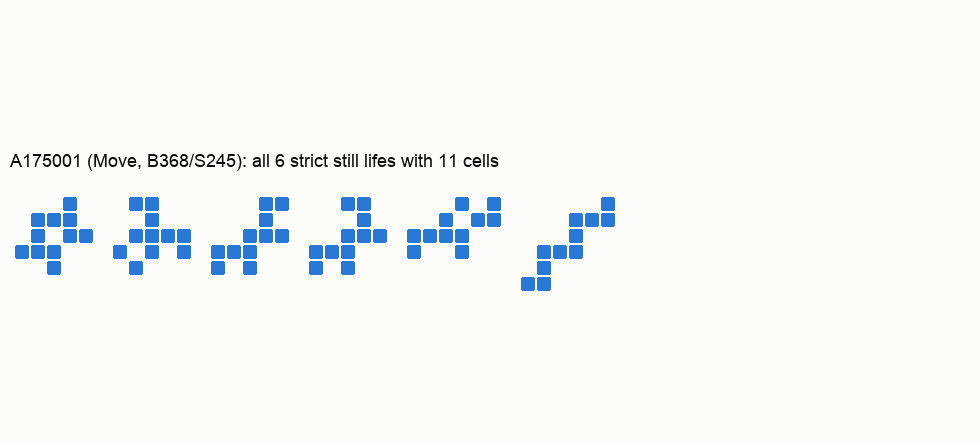
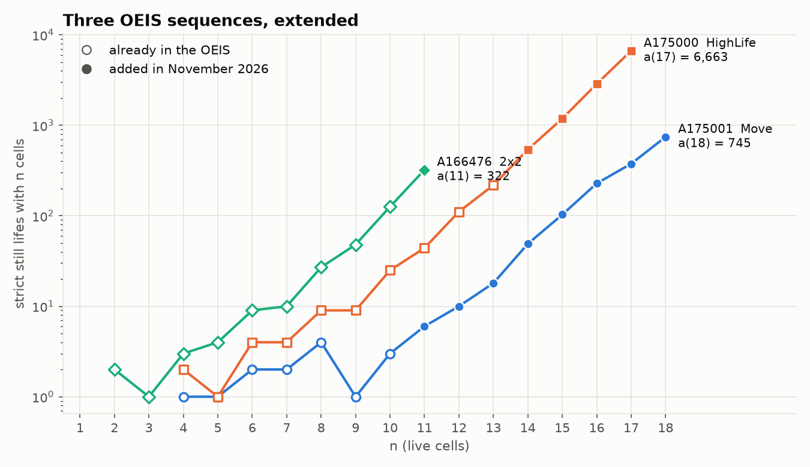
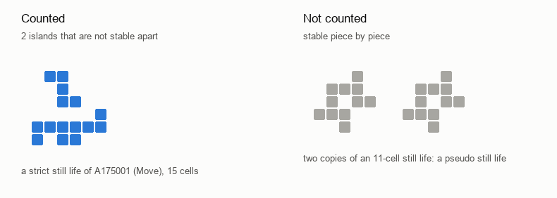
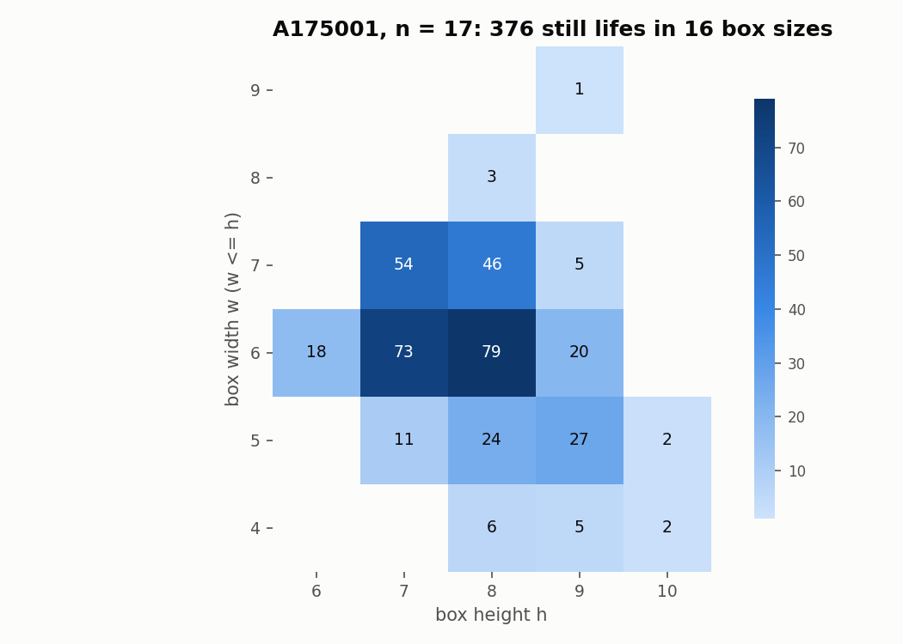

# Thirteen new OEIS terms: strict still lifes in Move, HighLife and 2x2

[](https://github.com/joelcanary/still-lifes-move-highlife-2x2/actions/workflows/test.yml)

Thirteen terms added to three sequences of the [On-Line Encyclopedia of Integer Sequences](https://oeis.org) that count **strict still lifes** in Life-like cellular automata, approved by the OEIS editors in November 2026, together with the two independent C programs that computed them, the per-box data behind every term and a test suite.

<p align="center"></p>

## The new terms

| Sequence | Rule | Known before | Added | Values |
|---|---|---|---|---|
| [A175001](https://oeis.org/A175001) | Move, B368/S245 | a(1)–a(10) | a(11)–a(18) | 6, 10, 18, 49, 103, 228, 376, 745 |
| [A175000](https://oeis.org/A175000) | HighLife, B36/S23 | a(1)–a(13) | a(14)–a(17) | 540, 1187, 2872, 6663 |
| [A166476](https://oeis.org/A166476) | 2x2, B36/S125 | a(1)–a(10) | a(11) | 322 |

None of the three had gained a term since 2010. The full sequences are in [`data/`](data) as b-files, identical to what the OEIS serves today.

<p align="center"></p>

## What is counted

A **Life-like rule** `B.../S...` says which neighbour counts make a dead cell be born (B) and a live cell survive (S): Conway's Game of Life is B3/S23. A **still life** is a finite pattern that never changes.

A still life is **strict** when it cannot be split into two or more pieces that are each stable on their own. Two separate copies of a still life form a stable pattern, but not a strict one, and these sequences count only strict ones, up to rotation and reflection. This is the definition LifeWiki uses, and the one under which the programs reproduce every term the OEIS already had.

<p align="center"></p>

## How the counting works

Both programs rest on one bound. A strict still life with *n* cells can never contain two empty rows in a row: the cells on either side of them would not interact, so each part would be stable alone. With at least one cell in every non-empty row, the pattern fits in a box no taller (or wider) than 2*n* − 1. Searching every box up to that size is therefore exhaustive.

Inside each box the two programs share nothing else:

| | [`stilllife.c`](src/stilllife.c) | [`crosscheck.c`](src/crosscheck.c) |
|---|---|---|
| Board | rows as 64-bit masks | matrix of cells |
| Search order | row by row | column by column |
| Pruning | the rule is checked on each cell as soon as its 8 neighbours are known | the same rule check, on the column order |
| Rotations and reflections | keeps only the smallest of the transforms | canonical form stored in a hash table |
| Strictness | backtracking search for a stable split of the islands | brute force over every split of the islands |

Every count is split by box size, and the two programs must agree on **every box**, not just on the total. The per-box counts for all thirteen new terms are in [`data/boxes/`](data/boxes).

<p align="center"></p>

## Verification

- **Two programs, every box.** For all thirteen new terms, both programs return the same count in every box. [`tests/run.sh`](tests/run.sh) checks this from the stored files, and that each term matches its b-file.
- **Published terms reproduced.** Both programs reproduce every term these entries already had, and the related ones too: A175001 to a(10), A175000 to a(13), A166476 to a(10), [A175002](https://oeis.org/A175002) (Maze) to a(9) and [A019473](https://oeis.org/A019473) (Conway) to a(15). The test suite recomputes the smaller of these on every run.
- **Every pattern drawn here is re-checked.** [`scripts/make_figures.py`](scripts/make_figures.py) simulates one generation of each pattern before drawing it and refuses any that changes.

Agreement between two programs is strong evidence, not a proof. Both were written for this work and share the bound above, so the argument for that bound matters as much as the code.

## Quick start

Requires a C compiler, `make` and a POSIX shell. The figures also need Python 3 with matplotlib and Pillow.

```sh
make            # builds build/stilllife and build/crosscheck
make test       # about a minute: published terms, box-by-box agreement, data files

build/stilllife B368/S245 13                      # one term, single process
sh scripts/count.sh build/stilllife B368/S245 15 4 | awk '{s += $3} END {print s}'   # split over 4 processes
DUMP=1 build/crosscheck B368/S245 11 2>&1 >/dev/null   # list the patterns themselves
```

The cost grows quickly with *n*: a(17) of A175001 took about an hour per program split over four processes, and a(11) of A166476 several hours.

## Use cases

- **Extending these sequences.** `scripts/count.sh` splits a term into independent boxes, so a larger *n* can be spread over several machines and the boxes added up.
- **Other rules.** Any rule without B0 works: `build/stilllife B3/S12345 9` counts Maze still lifes. Both programs agree on rules they were not written for, which is a useful check in itself.
- **Pattern catalogues.** [`data/patterns/`](data/patterns) lists every still life behind several of the new terms, one per line, in a form that is easy to parse.

## Repository layout

```
src/        the two enumerators
scripts/    count.sh (split by box), make_figures.py
data/       b-files, per-box counts for every new term, pattern lists
figures/    everything here is generated by scripts/make_figures.py
tests/      run.sh, the test suite run in CI
```

## Credits and licence

The terms were computed and submitted to the OEIS by Joel Cruz Cabrera ([ORCID 0009-0005-4048-1237](https://orcid.org/0009-0005-4048-1237)); each entry credits them in its Extensions line. The programs were written with the help of an AI coding assistant and checked as described above. The original sequences are by Christian Schroeder (A175000, A175001) and Nathaniel Johnston (A166476).

Code and data are released under the [MIT licence](LICENSE). To cite this repository, see [`CITATION.cff`](CITATION.cff).
